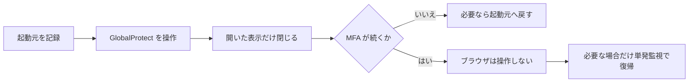

# 今後のタスク

## GlobalProtect の表示を閉じて起動元へ戻す

### 現状と方針

`status` などの状態取得は GlobalProtect のポップオーバーを開いたまま終了する。`connect` と接続方向の `toggle` は Connect を押すとすぐ終了するため、その後の Safari での MFA と GlobalProtect への復帰はコマンド終了後に起こる。

- コマンド開始前に最前面のアプリを PID で記録する。Terminal に固定せず、実際の起動元へ戻す。
- 最後の UI 操作後、コマンドが開いたポップオーバーがまだ表示されている場合だけ、閉じる操作を 1 回行う。確認画面や MFA を閉じない。GlobalProtect が最前面のときだけ起動元へ戻し、Safari やユーザーが選んだ別アプリが最前面なら触れない。
- MFA 後まで戻すには、即時終了する CLI とは別に、コマンドが起動する期限付きの単発監視処理が必要。アプリ切り替えを監視し、Safari から GlobalProtect に戻り、ユーザーが別アプリへ移っておらず、対象の表示が残っている場合にだけ閉じて起動元を前面にする。1 回処理したら終了し、期限切れでも終了する。メニューを繰り返し開いて状態確認しない。
- まずコマンド終了時の後片付けを実機で検証する。それで MFA 後も GlobalProtect が前面に残る場合に、単発監視処理を追加する。CLI を MFA 完了まで待機させる方式は、現行の即時終了という契約を変えるため採らない。

### 実装前に確認すること

- GlobalProtect のポップオーバーを、接続や確認画面を取り消さずに閉じる操作を実機で特定する。閉じる直前に対象の表示を確認し、メニューバー項目を無条件に押して再表示しない。
- `status`、接続・切断方向の `toggle`、`connect`、`disconnect`、`refresh` で、結果と終了コードを変えずに表示が閉じることを確認する。MFA中は Safari のフォーカスを奪わず、MFA後に GlobalProtect が前面になった場合だけ起動元へ戻す。
- ユーザーが途中で別アプリを選んだ場合、起動元が終了した場合、確認画面やエラー画面が残った場合はフォーカスを強制しない。表示を閉じる操作とフォーカス復帰はそれぞれ最大 1 回にする。

参考: [最前面アプリの取得](https://developer.apple.com/documentation/appkit/nsworkspace/frontmostapplication)、[アプリの再アクティブ化](https://developer.apple.com/documentation/appkit/nsrunningapplication/activate%28options%3A%29)、[アプリ切り替え通知](https://developer.apple.com/documentation/appkit/nsworkspace/didactivateapplicationnotification)。

## Refresh Connection の実機確認

以前の実機テストでは確認画面を見落としたが、修正後に接続済みから `gpctl refresh --verbose` を 1 回実行し、終了コード `0` と `refresh confirmation: confirmed` を確認した。ユーザーがブラウザで MFA を完了した後、`gpctl status --verbose` は終了コード `0` と `connected` を返した。更新の正常系は実機で一通り確認済み。

- メニューが既に開いている場合にも、オプションボタンを押し直さないことを確認する。
- 確認画面が表示されない環境でも、更新開始を正しく判定できるか確認する。

## MFA を完了しなかった場合の自動再接続

正常系の接続と更新は実機で確認済み。以下は未実装・未検証。

- 認証待ちが終了したことを、画面の `Connecting...` 表示だけに頼らず判定する方法を調べる。
- 終了が確認できた場合に限り、十分な待機時間を置いて接続操作を最大 1 回だけ再試行する。
- 接続処理中や MFA 画面の表示中は、メニューを開き直したり Connect を押し直したりしない。
- MFA 自体は自動操作せず、人が行う。
- 認証未完了、認証完了、画面の表示だけが固まった場合について、重複クリックが起きないテストを追加する。
